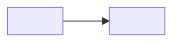

# Architecture

<!-- template:
How the system is divided: its components, what each is responsible for, how they talk,
and what lies outside it. The decisions in `plexus/decisions/` say *why*; this page says
*what is where*. Tasks name the components they work in, the implementing agent gets their
rows and links, and review checks that the code keeps to them. A small product has two or
three components; the page grows with the system, never ahead of it.
-->

## Components

| id | component | responsible for | spec parts | in code |
|---|---|---|---|---|
| component-01 | <name> | <what it owns — its data and behaviour> | <parts of the spec it serves> | `<path/>` |

## Links

<!-- template:
How the components talk: who calls whom, what goes across, and whether the caller waits.
-->

- <component-01 → component-02: what goes across, and how>

## Outside the system

| system | what we use it for | how we reach it | owned by |
|---|---|---|---|
| <name> | <purpose> | <an API, a file, a queue> | <a team or a vendor> |

## Diagram

